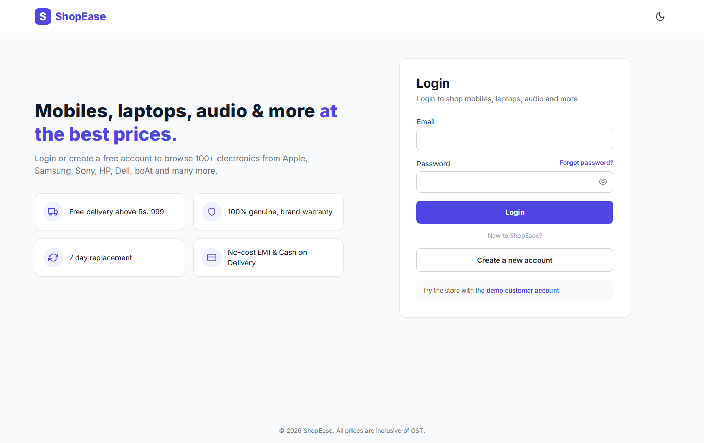
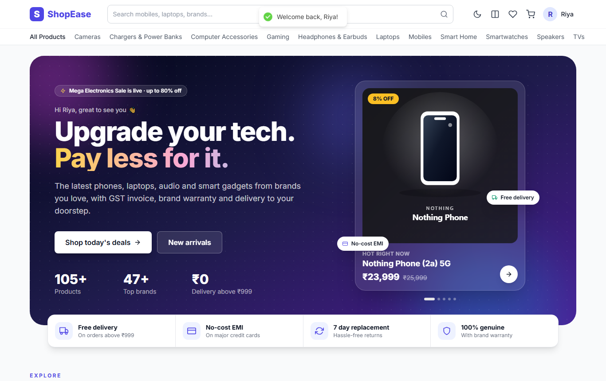
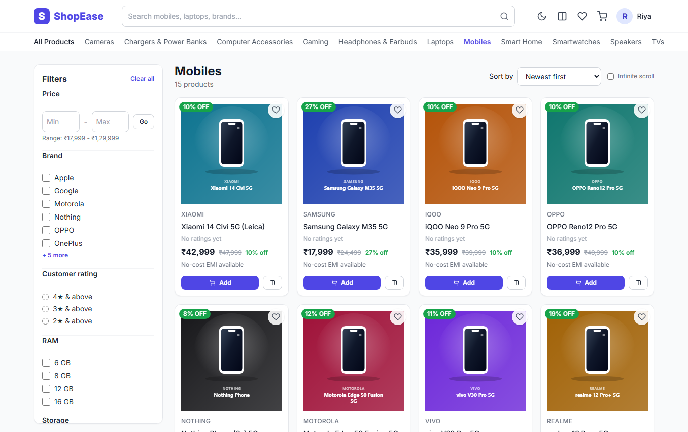
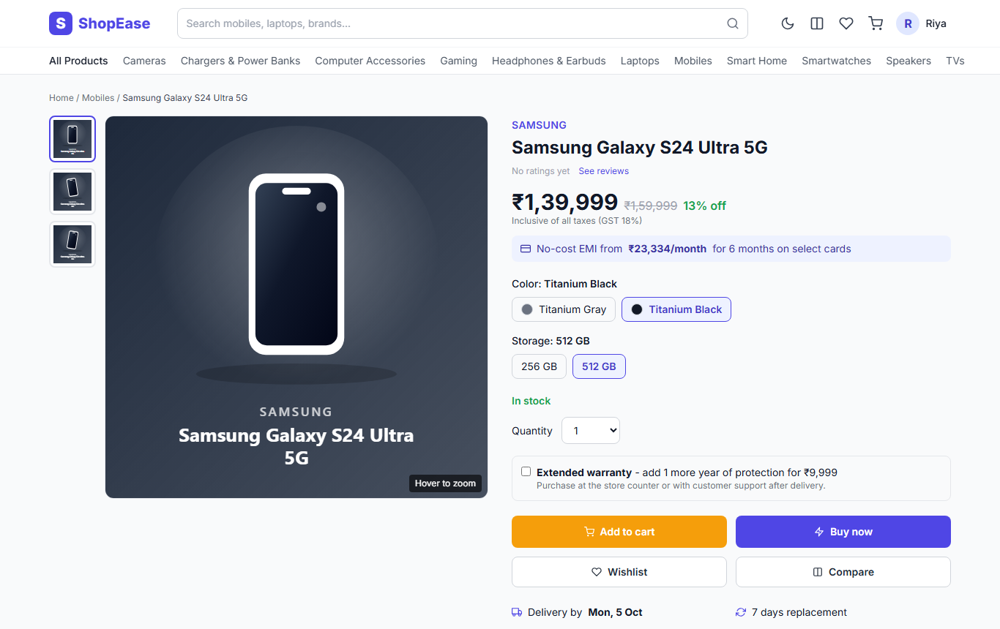
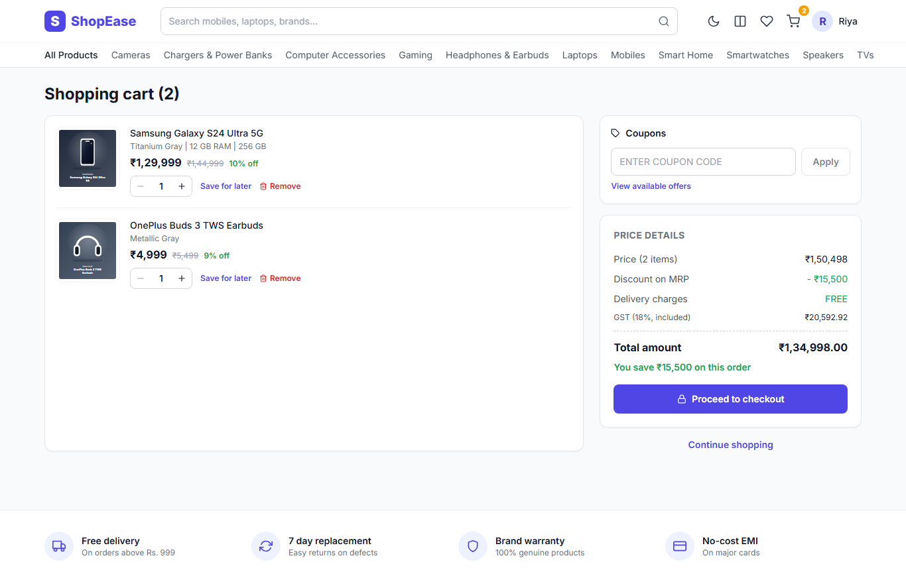
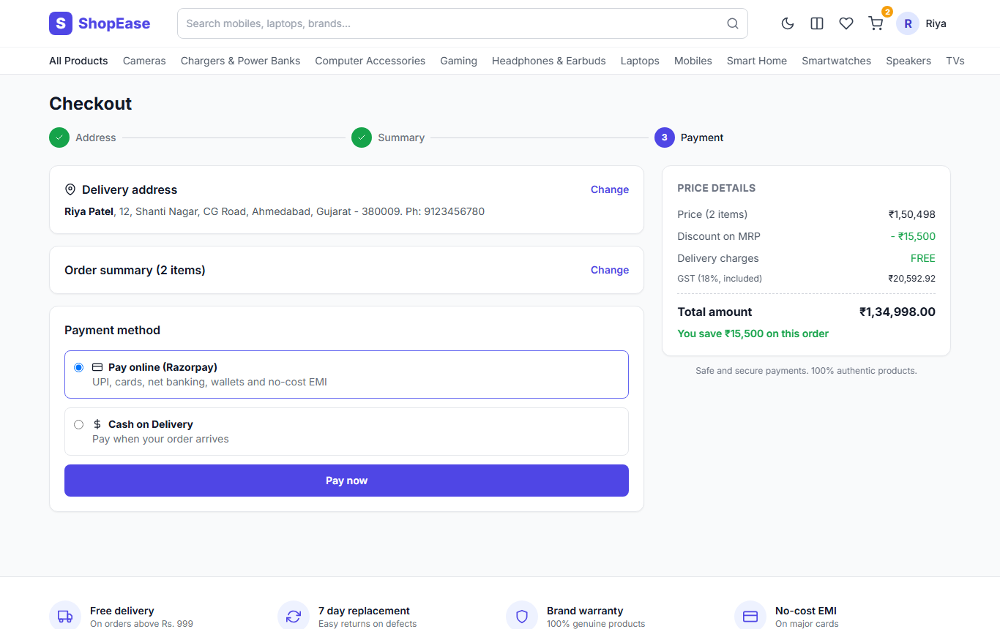
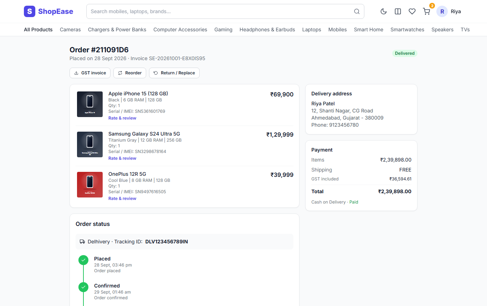
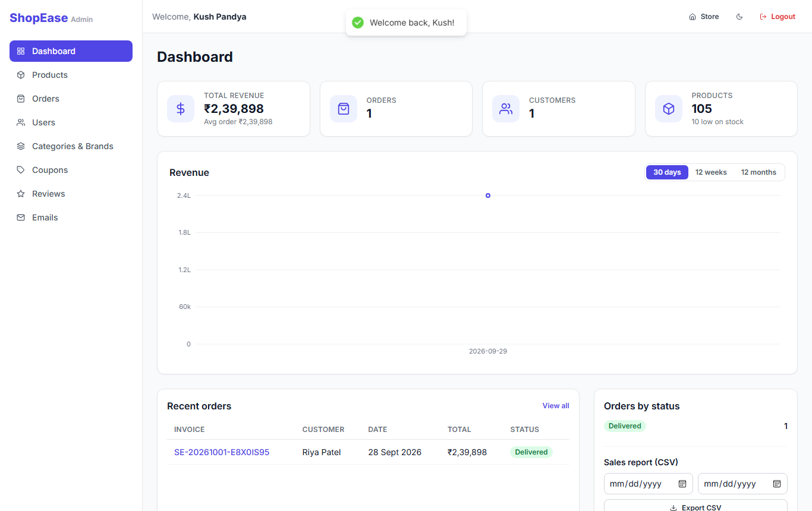
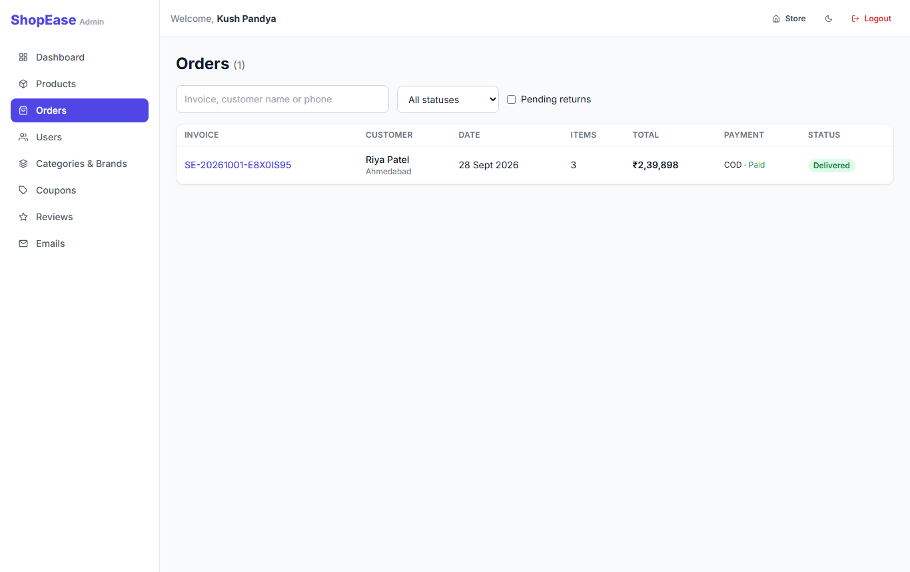
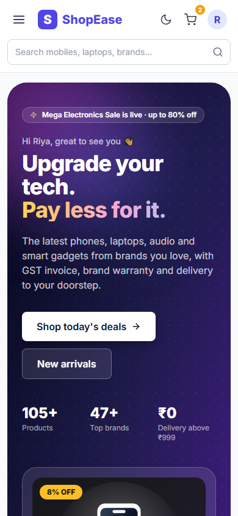

# ShopEase - Electronics E-Commerce Store

> A full-stack MERN store only for electronics: mobiles, laptops, audio, TVs, gaming and more. It has variant pricing, product compare, GST invoices, Razorpay payments and a complete admin panel.


**Live demo:** _add your Vercel link here_ · **API:** _add your Render link here_

| Role | Email | Password |
|------|-------|----------|
| Admin | set in `server/.env` (`ADMIN_LOGIN_EMAIL`) | set in `server/.env` (`ADMIN_LOGIN_PASSWORD`) |
| Customer | customer@shopease.com | Customer@123 |

The admin account is created automatically on start-up from `server/.env`:

```env
ADMIN_NAME=Your Name
ADMIN_LOGIN_EMAIL=you@example.com
ADMIN_LOGIN_PASSWORD=YourStrongPassword
```

Once a custom admin is set, the public demo admin (admin@shopease.com) is removed. If these values are left empty, the demo admin `admin@shopease.com` / `Admin@123` is used.

The demo customer already has one **delivered** order, so you can test reviews, invoices and returns straight away.

---

See [docs/REQUIREMENTS-CHECKLIST.md](docs/REQUIREMENTS-CHECKLIST.md) for the status of every item in the requirements document.

## Features

### Customer flow
1. Opening the site while logged out shows the **login page** (the whole store needs an account)
2. New visitors click **Create a new account** and register (name, email, mobile, password)
3. After registering they land on the **home page** and browse by category, search, filters and sort
4. They open a product, choose colour / RAM / storage and click **Add to cart** or **Buy now**
5. In the **cart** they change quantities and apply coupons (`WELCOME10`, `FLAT500`, `MEGA15`)
6. **Checkout**: 1) add or select an address, 2) review the order summary, 3) pay online (Razorpay) or choose Cash on Delivery
7. The **order confirmation** page appears, with order tracking, the GST invoice, cancel and return under *My orders*

### Customer
- Home page with a banner carousel, deals of the day, featured products, category cards, new arrivals, top brands and recently viewed items
- Debounced search with product and category suggestions (keyboard navigable)
- Filters: category, brand, price, rating, RAM, storage, battery, screen size, discount and availability
- Sort by price, newest, rating, popularity or discount. Choose paginated or infinite scroll
- Product page with a zoomable gallery, colour/RAM/storage variant selector (each variant has its own price and stock), a grouped specs table, highlights, warranty and extended warranty, no-cost EMI and the 7 day replacement policy
- Compare 2 to 4 products from the same category side by side (rows that differ are highlighted)
- Login-first store: every store page needs an account. Visitors are sent to login or register, and after logging in they return to the page they asked for. The server also rejects cart and order requests without a login. Stock is validated and coupons can be applied
- Wishlist, with move to cart
- 3 step checkout (address > summary > payment) with Razorpay (test mode) or Cash on Delivery
- Orders with a status timeline, cancel before shipping, return/replace within 7 days, **GST invoice PDF** and reorder
- Reviews only from verified buyers (one per product), star breakdown and helpful votes
- Profile with personal info, multiple addresses (set a default), password change and my reviews
- JWT access token (15 min, kept in memory) plus a rotating refresh token (7 days, httpOnly cookie). Forgot/reset password and email verification by email
- Dark mode, mobile first (works from 360px), SEO tags with react-helmet-async, lazy loaded images and routes

### Admin (`/admin`)
- Dashboard with revenue, orders, customers, average order value, a revenue chart (daily/weekly/monthly), orders by status, top sellers, low stock alerts and a CSV sales report
- Products: create/edit with Cloudinary multi-image upload (or image URLs), variants, specifications, warranty, featured/active toggles
- Orders: filter and search, update status, add courier and tracking ID, **save serial number / IMEI for each item**, approve or reject returns
- Users: search, block/unblock, change role
- Categories (with sub-categories), brands and home banners
- Coupons: percent or flat, minimum order, maximum discount, expiry, usage limit
- Review moderation

### Business rules (enforced on the server)
| Rule | Implementation |
|------|----------------|
| Price | The variant price is always read from the database and the client price is never trusted. Discount % = (MRP - price) / MRP |
| GST | 18%, included in the price. The invoice shows taxable value + CGST 9% + SGST 9% |
| Shipping | Free when the amount after discount is at least Rs. 999, otherwise Rs. 49 |
| Stock | Decremented atomically when the order is placed (with rollback) and restored on cancel or approved return |
| Payment | An online order is created only after the Razorpay HMAC signature and the amount are verified. The webhook is also verified |
| Cancel | Only in `placed`, `confirmed` or `packed` status |
| Return | Within 7 days of delivery |
| Review | Only buyers with a delivered order. One review per user per product (unique index) |
| Coupon | Expiry, minimum order, usage limit and maximum discount are checked on every cart read and at order time |
| Compare | Same category only |

---

## Tech stack

**Frontend:** React 18 + Vite 8, Tailwind CSS (dark mode), Redux Toolkit + RTK Query, React Router v7, React Hook Form + Zod, Framer Motion, Swiper, Recharts, React Hot Toast, React Icons, react-helmet-async

**Backend:** Node.js, Express, MongoDB + Mongoose, JWT + bcryptjs, cookie-parser, Multer + Cloudinary, Razorpay, Nodemailer, PDFKit, express-validator, helmet, cors, express-rate-limit, express-mongo-sanitize, xss, morgan + winston, slugify, node-cron

**Testing:** Jest + Supertest + mongodb-memory-server (API), Vitest + React Testing Library (UI) · **CI:** GitHub Actions

---

## Project structure

```
shopease/
├── client/                    # React app (Vite)
│   └── src/
│       ├── app/store.js       # Redux store + localStorage persistence
│       ├── components/        # common/, product/, cart/, admin/
│       ├── features/          # auth, cart (guest), compare, recent, ui slices
│       ├── hooks/             # useCart, useWishlist, useCompare, useAuthBootstrap...
│       ├── layouts/           # MainLayout, AdminLayout
│       ├── pages/             # store pages + admin/
│       ├── routes/            # ProtectedRoute, AdminRoute, GuestRoute
│       ├── services/          # RTK Query API slices (auto token refresh)
│       ├── tests/             # Vitest + RTL
│       └── utils/
├── server/                    # Express API
│   ├── config/                # db, cloudinary, razorpay, logger
│   ├── controllers/
│   ├── middleware/            # auth/admin, error, upload, validate, xss, rateLimit
│   ├── models/                # User, Category, Brand, Product, Cart, Order, Review, Coupon, Banner
│   ├── routes/
│   ├── services/              # cart, order, email, invoice (PDF)
│   ├── jobs/                  # daily low stock email (node-cron)
│   ├── seeds/                 # 105 sample electronics products
│   ├── public/products/       # sample product photos (Wikimedia Commons, credits in CREDITS.md)
│   ├── tests/
│   ├── app.js
│   └── server.js
├── docs/ShopEase.postman_collection.json
└── .github/workflows/ci.yml
```

---

## Getting started

### Quick start on Windows (no installs needed)
Double-click **`start.bat`**. It will:
1. use your Node.js, or download a portable Node.js 20 into `%USERPROFILE%\nodejs-portable` if none is installed
2. install dependencies on the first run
3. create `server/.env` with `MONGO_URI=memory`, a built-in local MongoDB whose data is kept in `server/.data`
4. load the sample data automatically on the first run (105 products)
5. build the website and serve it together with the API on **one port (5000)**, then open the browser

| Open on | URL |
|---|---|
| This computer | http://localhost:5000 (the old link http://localhost:5173 also works) |
| Other computers / phones on the same Wi-Fi | http://&lt;this-PC-IP&gt;:5000 (start.bat prints the exact address) |
| Any phone / computer, any network or mobile data | optional **public link** – off by default (see below) |

**Public link (optional, off by default).** With `PUBLIC_LINK=true` in `server\.env`, `start.bat` (and the hidden auto-start) also starts a free [Cloudflare quick tunnel](https://developers.cloudflare.com/cloudflare-one/connections/connect-networks/do-more-with-tunnels/trycloudflare/) (`tools\cloudflared.exe`, downloaded on first use; no account needed). A watcher restarts it if it stops. The link works only while this computer is on, and it **changes every time the tunnel restarts**: `public-link.bat` and the admin dashboard always show the current one, and emails use it automatically. For a permanent address, deploy to a host (see *Deployment*) or use a named Cloudflare tunnel with your own domain. `public-link.bat` starts it once by hand. Anyone with the link can open the store, so keep the admin password strong.

| Script | What it does |
|---|---|
| `start.bat` | Start ShopEase (close its window to stop) |
| `stop.bat` | Stop ShopEase, including when it runs hidden (and its public link) |
| `public-link.bat` | Show (and copy) the current public link; starts it if needed |
| `allow-network.bat` | One time: allow other devices through Windows Firewall (asks for admin) |
| `install-autostart.bat` | Start ShopEase hidden every time you sign in to Windows, so the URL always works |
| `remove-autostart.bat` | Turn auto-start off |
| `reset-data.bat` | Delete local data and start fresh (stop ShopEase first) |

Moving the project to another computer: copy the whole folder and double-click `start.bat`. It installs Node.js and the dependencies on first run, which needs internet.

> If `mongod` fails with exit code `3221225781`, the Visual C++ runtime is missing. The server copies it from Microsoft Edge automatically. If Edge is not installed, install [vc_redist.x64.exe](https://aka.ms/vs/17/release/vc_redist.x64.exe).

### Manual setup
**Prerequisites:** Node.js 18+ (20 LTS recommended). For MongoDB, use a local server or a free Atlas cluster, or set `MONGO_URI=memory` for the built-in development database.

```bash
# 1. Clone
git clone https://github.com/<you>/shopease.git
cd shopease

# 2. Install
npm install              # root helper (concurrently)
npm run install:all      # server + client

# 3. Environment
cp server/.env.example server/.env    # fill in MONGO_URI and JWT secrets at minimum
cp client/.env.example client/.env    # keep VITE_API_URL empty for local dev

# 4. Seed sample data (12 categories, 47 brands, 105 products, coupons, banners, demo users)
npm run seed

# 5. Run API (5000) and web app (5173) together for development (hot reload)
npm run dev
```

Open http://localhost:5173.

### Optional services
| Service | What happens without it |
|---------|-------------------------|
| **Cloudinary** | Admin image upload returns 503. You can still add products with image URLs |
| **Razorpay** | With `PAYMENT_MOCK=true` (development only) online payment is simulated. Otherwise only COD is available |
| **SMTP** | Emails go to a free **Ethereal test mailbox**. Open each one from **Admin > Emails** ("View"). Double-click **`setup-email.bat`** to send real emails through Gmail (App Password) or any SMTP |

Razorpay test card: `4111 1111 1111 1111`, any future expiry, any CVV. Test UPI: `success@razorpay`.

### Emails
Welcome, verify email, password reset, order confirmation, shipped / out for delivery / delivered / cancelled, and the low stock alert to the admin.

1. Double-click **`setup-email.bat`** and enter your Gmail address and a Gmail **App Password** (create it at https://myaccount.google.com/apppasswords, which needs 2-Step Verification). The settings are saved only in `server/.env`, and a test email is sent.
2. Restart the app (`start.bat`).
3. **Admin > Emails** shows the delivery mode, every email with its status, and a "Send test" button.

Without SMTP the emails go to a test mailbox (development only), so nothing breaks while you set it up.

### Scripts
| Where | Command | Purpose |
|-------|---------|---------|
| root | `npm run dev` | API + client together |
| root | `npm test` | all tests |
| server | `npm run seed` / `npm run seed:destroy` | load / wipe sample data |
| server | `npm test` | Jest + Supertest (in-memory MongoDB) |
| client | `npm test` | Vitest + React Testing Library |
| client | `npm run build` | production build |

---

## API overview

Base URL: `/api`. The full request list is in [`docs/ShopEase.postman_collection.json`](docs/ShopEase.postman_collection.json). Import it into Postman or Thunder Client and run **Auth > Login** first.

| Area | Endpoints |
|------|-----------|
| Auth | `POST /auth/register` `POST /auth/login` `POST /auth/logout` `POST /auth/refresh-token` `POST /auth/forgot-password` `PUT /auth/reset-password/:token` `GET /auth/verify-email/:token` |
| Users | `GET/PUT /users/me` `PUT /users/me/password` `POST /users/me/addresses` `PUT/DELETE /users/me/addresses/:id` `GET/POST /users/me/wishlist` `DELETE /users/me/wishlist/:productId` · admin: `GET /users` `PUT /users/:id` |
| Products | `GET /products` (q, category, brand, minPrice, maxPrice, rating, ram, storage, battery, screen, minDiscount, inStock, sort, page, limit) `GET /products/filters` `GET /products/suggest` `GET /products/featured\|new\|deals` `GET /products/:slug` `GET /products/:id/related` `POST /products/compare` · admin: `GET /products/admin/all` `POST /products` `PUT/DELETE /products/:id` |
| Catalog | `GET /categories` `GET /brands` `GET /banners` · admin: POST / PUT / DELETE |
| Cart | `GET /cart` `POST /cart/items` `PUT/DELETE /cart/items/:itemId` `POST /cart/merge` `POST /cart/coupon` `DELETE /cart` |
| Orders | `POST /orders` (COD) `GET /orders/my` `GET /orders/:id` `PUT /orders/:id/cancel` `POST /orders/:id/return` `GET /orders/:id/invoice` · admin: `GET /orders` `PUT /orders/:id/status` `PUT /orders/:id/return` |
| Payments | `POST /payments/create-order` `POST /payments/verify` `POST /payments/webhook` |
| Reviews | `GET /reviews/product/:productId` `POST /reviews/product/:productId` `PUT/DELETE /reviews/:id` `POST /reviews/:id/helpful` · admin: `GET /reviews/admin/all` `DELETE /reviews/admin/:id` |
| Coupons | `GET /coupons/available` `POST /coupons/validate` · admin CRUD |
| Admin | `GET /admin/stats?period=daily\|weekly\|monthly` `GET /admin/sales-report?from&to` |
| Upload | `POST /upload?folder=products` (multipart `images`, admin, max 8 files of 2 MB) |

---

## Security checklist
- [x] bcrypt (12 rounds) password hashing
- [x] Short-lived access token in memory, rotating hashed refresh token in an httpOnly + secure + SameSite cookie
- [x] helmet, CORS whitelist (`CLIENT_URL`), global rate limit plus a strict limit on login/register/password routes
- [x] express-validator on every write route, NoSQL injection sanitisation, XSS stripping of request bodies
- [x] Razorpay payment + webhook signature verification (timing-safe compare) and a server-side amount check
- [x] Prices, discounts, GST and shipping always calculated on the server
- [x] Role-based admin routes, blocked users are forced to log out
- [x] Upload type (JPG/PNG/WEBP/AVIF) and size (2 MB) limits
- [x] `.env` is git-ignored, and stack traces are hidden in production

---

## Deployment

**Easiest: one Render service + MongoDB Atlas** (works while your own computer is off). Step-by-step guide: [ONLINE-SETUP.md](ONLINE-SETUP.md).
`render.yaml` (Blueprint) builds the website and serves it together with the API on one https address. `publish-online.bat` pushes the project to GitHub, and `copy-data-to-cloud.bat` copies this computer's data to Atlas. In production the server refuses to start without your own admin login and real JWT secrets, so the public demo admin never exists online.

The alternative below uses a separate frontend host:
1. **MongoDB Atlas**: create a free cluster, add a database user, allow network access, and copy the connection string into `MONGO_URI`.
2. **Cloudinary**: copy the cloud name, API key and secret.
3. **Backend on Render / Railway**: set the root directory to `server`, the build command to `npm install` and the start command to `npm start`. Add every variable from `server/.env.example` and set `NODE_ENV=production` and `CLIENT_URL=https://<your-app>.vercel.app`. Run `npm run seed` once from the Render shell.
4. **Frontend on Vercel / Netlify**: set the root directory to `client`, the build command to `npm run build` and the output directory to `dist`. Set `VITE_API_URL=https://<your-api>.onrender.com/api`. SPA rewrites are already in `vercel.json` and `public/_redirects`.
5. **Razorpay**: use test keys and add a webhook at `https://<api>/api/payments/webhook` for `payment.captured`, with the same secret as `RAZORPAY_WEBHOOK_SECRET`.
6. Test end to end: register, add to cart, pay, then as admin ship and deliver the order, review it and download the invoice.

> The refresh cookie uses `SameSite=None; Secure` in production so it works across the Vercel and Render domains.

---

## Screenshots
| Login (store is login-first) | Home |
|---|---|
|  |  |
| **Category listing with filters** | **Product detail (variants, EMI, warranty)** |
|  |  |
| **Cart with price details** | **3-step checkout** |
|  |  |
| **Order tracking, serial / IMEI, GST invoice** | **Admin dashboard** |
|  |  |
| **Admin order management** | **Mobile (390px)** |
|  |  |

## Future scope
- Google OAuth login, Stripe as a second gateway
- AI recommendations ("you may like"), a product help chatbot and AI compare summaries
- Price history chart, price drop and back-in-stock alerts
- "Frequently bought together", voice search
- PWA, Gujarati / Hindi language support
- Redis caching, MongoDB Atlas Search, Socket.io live order notifications for admin
- Docker setup, bulk CSV product upload

**Repo topics:** `mern` `ecommerce` `tailwindcss` `redux-toolkit` `razorpay` `electronics-store`

## License
MIT
